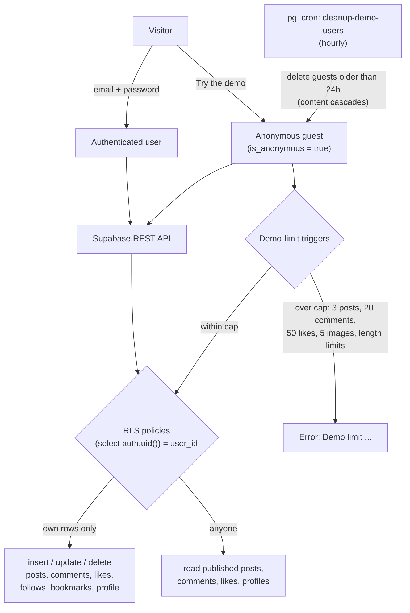
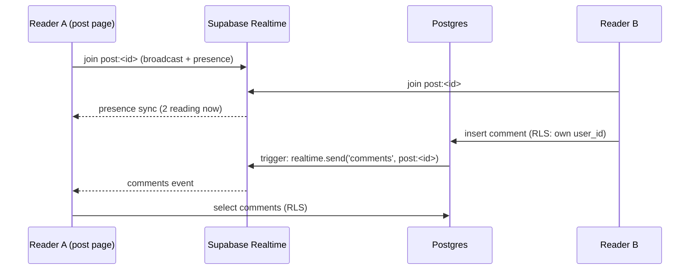
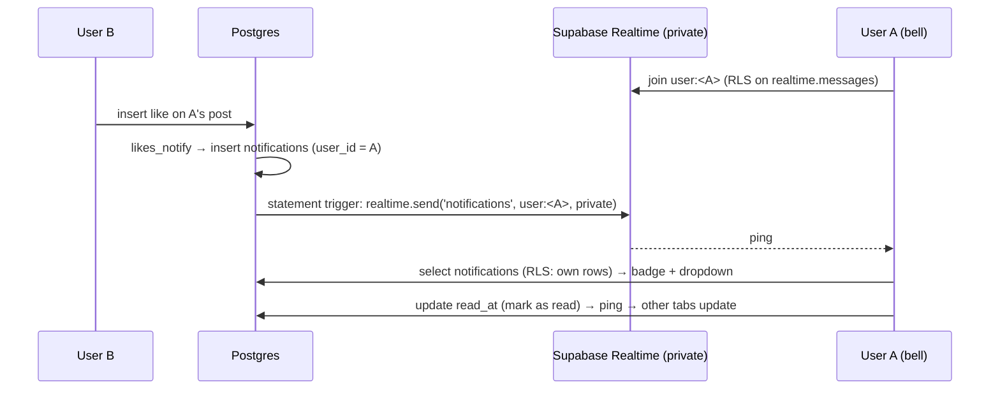
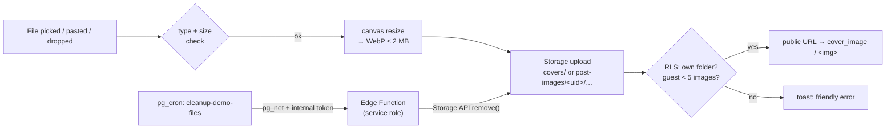

# Blog Platform

[](https://github.com/JoshuaMColon/blog-platform/actions/workflows/ci.yml)

A full-stack blogging app built with React 19, TypeScript, Tailwind CSS and Supabase. It covers sign-up and login, a TipTap rich-text editor, comments, likes, follows, bookmarks, tag search and a one-click guest demo, with Postgres row-level security (RLS) doing the access control.

**Live:** https://blog-platform-one-xi.vercel.app

> A portfolio project. It's a working app with real auth and data, not a hardened production service; see [Known limits](#known-limits).

---

## Features

- **Auth**: email/password sign-up and login, plus an optional anonymous **guest demo**
- **Posts**: create, edit, delete, draft or publish, with tags, a cover image and rich text (TipTap)
- **Image uploads**: cover images and inline editor images (button, paste or drop), resized and compressed to WebP in the browser, stored in Supabase Storage under each user's own folder
- **Social**: comments (edit and delete your own), likes, follows, bookmarks and a following feed
- **Notifications**: get notified when someone follows you, likes your post or comments on it. A navbar bell shows a live unread badge (private Realtime channel), with a dropdown, a full `/notifications` page and mark-as-read
- **Live updates**: comments and like counts update in real time, the feed shows an "N new posts" pill, and post pages show how many people are reading right now (Supabase Realtime broadcast + presence)
- **Discovery**: search by title or content, and filter by tag
- **Themes**: five colour themes with a light/dark toggle
- **Feel**: subtle press feedback on every control (mouse and touch), spinners on async actions, and optimistic likes that roll back if the write fails
- **SEO**: per-page titles, meta description, Open Graph/Twitter cards, `robots.txt` and a generated `sitemap.xml`

---

## Technology Stack

| Layer      | Technology                                     |
| ---------- | ---------------------------------------------- |
| Frontend   | React 19 + TypeScript, Vite, React Router 7    |
| Styling    | Tailwind CSS, framer-motion                    |
| Editor     | TipTap (lazy-loaded on the create/edit routes) |
| Backend    | Supabase (Auth, Postgres + RLS, Realtime, Storage, Cron) |
| Testing/CI | GitHub Actions, ESLint, TypeScript, Playwright |
| Deployment | Vercel (SPA rewrite in `vercel.json`)          |

---

## Getting Started

### Prerequisites

- Node.js 18+
- Supabase account

### Installation

1. Clone the repository

   ```bash
   git clone https://github.com/JoshuaMColon/blog-platform.git
   cd blog-platform
   ```

2. Install dependencies

   ```bash
   npm install
   ```

3. Configure environment variables

   Create a `.env` file in the project root:

   ```env
   VITE_SUPABASE_URL=your_supabase_project_url
   VITE_SUPABASE_ANON_KEY=your_supabase_anon_key
   ```

4. Initialize the Supabase schema

   The base tables (`profiles`, `posts`, `comments`, `likes`, `follows`, `bookmarks`) were created in the Supabase dashboard and aren't in this repo yet. Everything added since then (guest demo, RLS tuning, generated excerpt/reading-time columns) is in `supabase/migrations/`.

5. Start the development server

   ```bash
   npm run dev
   ```

   Open http://localhost:5173.

6. Checks and tests

   ```bash
   npm run typecheck && npm run lint && npm run build
   npx playwright install chromium   # first run only
   npm run test:e2e                  # builds, serves with vite preview, runs Playwright
   ```

   Set `BASE_URL=https://your-preview.vercel.app` to run the same tests against a deployed preview.

---

## Usage

### Visitor Experience

- Post pages (`/post/<slug>`) and search are public; the home feed, following, bookmarks and all writes need an account or the guest demo

### Author Workflow

- Create a new post with title, tags, cover image, and rich text content
- Publish posts publicly or keep them as drafts for later editing
- Update or remove any post authored by the signed-in user

### Interaction Features

- Leave comments on posts, and edit or delete your own
- Like or unlike posts, follow authors and bookmark posts
- Get follow / like / comment notifications in the navbar bell and on `/notifications`
- Pick one of five themes and toggle light/dark

---

## Project Structure

```
src/
├── components/        # Reusable UI components and feature widgets
├── context/           # Global auth and theme providers
├── hooks/             # useDocumentTitle (per-page title/meta)
├── lib/               # Supabase client, shared Realtime channels, image upload helpers, notifications store
├── pages/             # Route-based page components (heavy ones lazy-loaded)
├── utils/             # sanitising, slugs, reading time, press feedback
└── App.tsx            # Application routes and providers
e2e/                   # Playwright tests
scripts/               # generate-sitemap.mjs (runs after vite build)
supabase/migrations/   # SQL migrations
supabase/functions/    # Edge Functions (Deno)
```

---

## Guest demo mode

The login screen has a **Try the demo** button that signs visitors in with Supabase anonymous auth.

- Guests can read everything and create posts, comments, likes, follows and bookmarks within small caps (3 posts, 20 comments, 50 likes, 5 images, length limits). RLS still stops them editing or deleting anyone else's content.
- A **DEMO** badge shows in the navbar while you're signed in as a guest.
- A `pg_cron` job (`cleanup-demo-users`, hourly) deletes anonymous users older than 24 hours. Their content goes with them through cascading foreign keys.
- A second job (`cleanup-demo-files`, hourly) calls an Edge Function that deletes guests' uploaded images (and any orphaned files) through the Storage API.
- Sample posts are seeded by the `blog_team` account.
- **Requires:** Supabase Dashboard → Authentication → Sign In / Providers → **Allow anonymous sign-ins**. Until that's on, the button shows a friendly "not switched on yet" message.

Database changes live in `supabase/migrations/`.

### How access control works



- Every write policy checks ownership with `(select auth.uid())`, so Postgres evaluates it once per query instead of once per row.
- A `BEFORE UPDATE` trigger on `comments` stops `post_id`, `user_id` and `created_at` from changing when someone edits a comment.
- `posts.excerpt` and `posts.reading_minutes` are generated columns, so feed cards never download full post bodies.

---

## Live updates (Realtime)

Database triggers broadcast small "something changed" events on **public** Realtime channels. Clients then re-read through the normal RLS-protected API, so a broadcast never carries row data a reader couldn't already see (drafts never trigger anything).

| Channel          | Event      | Sent when                                   | Client reaction                       |
| ---------------- | ---------- | ------------------------------------------- | ------------------------------------- |
| `post:<post_id>` | `likes`    | a like is added or removed                  | like button re-reads count and state  |
| `post:<post_id>` | `comments` | a comment is added, edited or deleted       | comment list re-reads                 |
| `post:<post_id>` | presence   | a tab opens or leaves the post              | "N reading now" counter               |
| `feed`           | `new_post` | a post is inserted published, or published  | "↑ N new posts" pill on the feed      |



`src/lib/realtime.ts` keeps **one ref-counted channel per topic** (the like button, comments and presence counter on a post page share it), and every component unsubscribes on unmount; the socket channel is removed shortly after its last user goes away.

---

## Notifications

`public.notifications` holds one row per event for the **recipient** (`user_id`), written only by `security definer` triggers in the non-exposed `private` schema:

| Source table | Trigger | Notification | Undo |
| --- | --- | --- | --- |
| `follows` | `follows_notify` | `follow` → `/profile/<actor>` | unfollow deletes it |
| `likes` | `likes_notify` | `like` → `/post/<slug>` | unlike deletes it |
| `comments` | `comments_notify` | `comment` → `/post/<slug>#comments` | deleting the comment cascades |

- **Never yourself:** triggers skip self-actions and a `check (user_id <> actor_id)` backs that up. Likes and follows are de-duplicated with a unique index, so liking, unliking and liking again leaves one notification.
- **RLS:** clients can only `select`/`delete` their own rows and only `update (read_at)` (column-level grant). There is no insert grant at all. Rows older than 90 days are pruned by `pg_cron`.
- **Live badge:** a statement-level trigger sends one tiny `{op}` ping per affected recipient with `realtime.send(..., 'user:<uid>', private => true)`. An RLS policy on `realtime.messages` only lets `auth.uid()` join its own `user:<uid>` topic, and the client then re-reads its notifications through RLS, so the ping carries no data.



`src/lib/notifications.ts` keeps one shared store per signed-in user (read through `useSyncExternalStore`), so the bell, the dropdown and the page share one channel and one unread count across components.

---

## Image uploads (Storage)

| Bucket | Used for | Max longest edge | Limits (enforced by Storage) |
| --- | --- | --- | --- |
| `covers` | post cover images (cards + post header) | 1600 px | 2 MB, JPEG/PNG/WebP/GIF |
| `post-images` | images inside post content | 1400 px | 2 MB, JPEG/PNG/WebP/GIF |

- **Client side** (`src/lib/images.ts`): accepts JPG/PNG/WebP/GIF up to 10 MB, downsizes with a canvas and re-encodes to WebP (JPEG fallback), lowering quality until it fits under 2 MB. A 4.9 MB PNG becomes a ~120 KB WebP. Animated GIFs become a still image.
- **Paths** are `<bucket>/<uid>/<random uuid>.webp`. RLS only allows insert/update/delete (and listing) inside your own `<uid>/` folder. Both buckets are public, so images are served from the public CDN URL, and nobody can list other users' files.
- **Guests** can store at most 5 images (a restrictive policy backed by a security-definer counter in the non-exposed `private` schema). They can only set covers from their own folder.
- **Rendering:** the sanitizer only keeps `` tags whose `src` is in this project's buckets, so posts can't embed tracking pixels or hot-link other sites. Images are lazy-loaded.



The Edge Function (`supabase/functions/cleanup-demo-files`) checks a random token stored in Supabase Vault, so it needs no project key in the database or the repo.

---

## Performance & Lighthouse

Lighthouse (lab run, mobile uses the default Moto G Power throttling, desktop the desktop preset) on the live site. "Home" is `/`, which redirects logged-out visitors to `/login`.

| Page | Device  | Performance (before → after) | Accessibility | Best Practices | SEO        |
| ---- | ------- | ---------------------------- | ------------- | -------------- | ---------- |
| Home | Mobile  | 95 → 88                      | 91 → 94       | 96 → 96        | 82 → 100   |
| Home | Desktop | 100 → 99                     | 91 → 94       | 100 → 100      | 82 → 100   |
| Post | Mobile  | 80 → 84                      | 85 → 90       | 100 → 100      | 82 → 100   |
| Post | Desktop | 99 → 90                      | 85 → 90       | 100 → 100      | 82 → 100   |

_30 Oct 2026. "Before" is a single run; "after" is the median of three runs after the perf/SEO pass. Lab performance scores on this setup swing by 10+ points between runs (for example, post desktop scored 89, 99 and 90), so treat performance differences of that size as noise. The accessibility, SEO and best-practices changes are stable. The remaining accessibility misses are colour contrast and links distinguished only by colour, both theme decisions that were left as is on purpose._

---

## Known limits

- **Contrast:** some theme accent colours fail WCAG AA contrast on light backgrounds, which is most of the Accessibility deduction. The themes haven't been changed.
- **Guest demo** needs **Allow anonymous sign-ins** turned on in Supabase, and ideally CAPTCHA to slow down bots.
- **Leaked-password protection** (Supabase Auth → Attack Protection) is off.
- **The base schema** isn't checked in as a migration (see step 4).
- **Search** is a simple `ilike` match, not full-text search.
- **The main JS bundle** is still about 190 KB gzipped (Supabase client, framer-motion, router); the editor and authoring pages are split out.

---

_Created by Joshua Colon_
